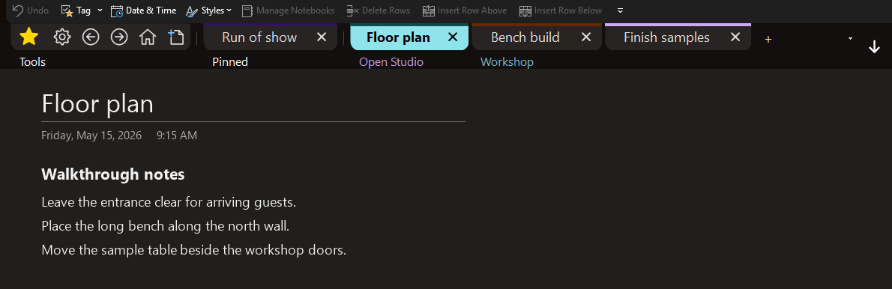
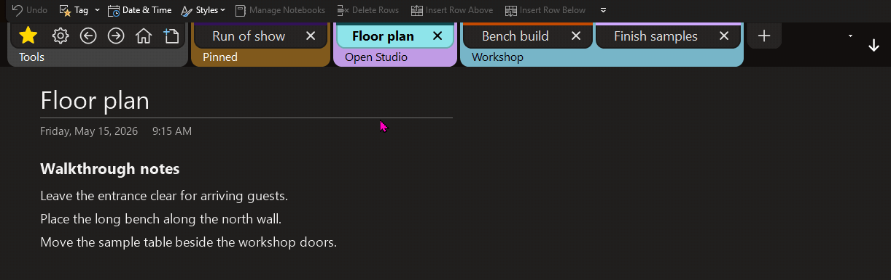
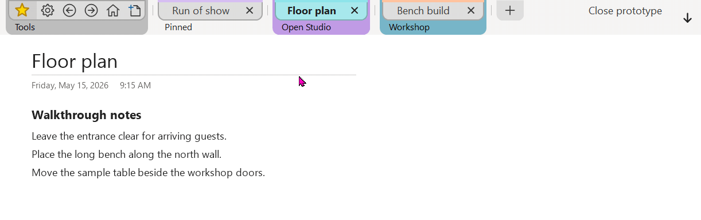
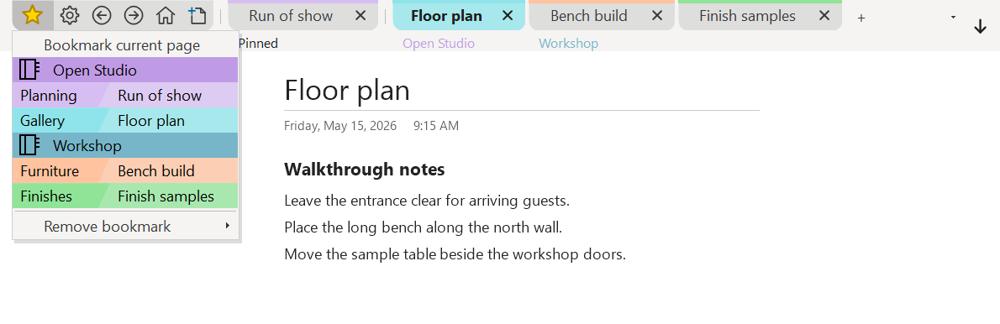

# MoreNotes

*It's OneNote, but More!*

MoreNotes is a collection of add-ins for **OneNote on Windows desktop**. Today the collection features one add-in, **MoreTabs**.

## MoreTabs

Keep the pages you use together in one OneNote window, even when they live in different notebooks. Pin the schedule you check all day, leave a floor plan and a set of workshop notes open beside it, and pick up where you left off when you restart MoreTabs.

**Available as a Windows desktop prototype.** [Build and run MoreTabs](addins/page-tabs/README.md#run-the-prototype) · [Browse the source](addins/page-tabs/prototype)

The strip sits below the Quick Access Toolbar. The arrow at the far right moves it to the bottom of the window. The previews use the actual MoreTabs controls with fictional notebooks and a sample page canvas.

### Switch notebooks with a click

Click a tab to display its page. Here, **Floor plan** belongs to *Open Studio*, while **Bench build** and **Finish samples** belong to *Workshop*. The section color and filled tab show which page is active.

### Open an existing page in a new tab

Click **+** and follow the notebook and section to the page you want. Choosing **Workshop → Furniture → Cut list** opens a separate tab and keeps the other pages available.

### Find a bookmark by notebook and section

The gold star opens your bookmarks. Notebooks appear in alphabetical order, and each colored section label shows where a page lives. Bookmarks stay available after you close their tabs.

The gear lets you choose your Home page, set the destination for new notes, and show or hide individual Tools buttons. [MoreTabs controls and settings](addins/page-tabs/README.md#saved-tabs-and-bookmarks)

## About the collection

Each add-in lives under `addins/` and can be installed and updated independently. Its GitHub Release carries its installer and release notes. MoreTabs uses release tags of the form `page-tabs/vX.Y.Z`. The prototype currently builds from source.

[MoreNotes artwork](assets/brand) · [MoreTabs logo](addins/page-tabs/media/moretabs-logo.png)
