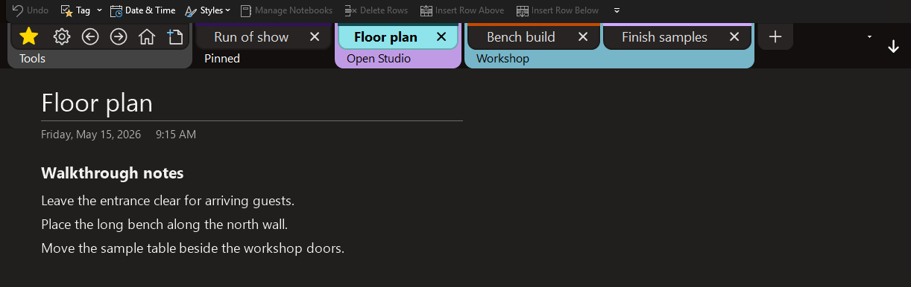
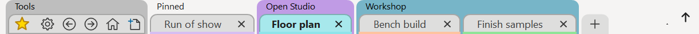
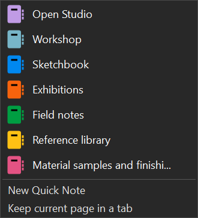
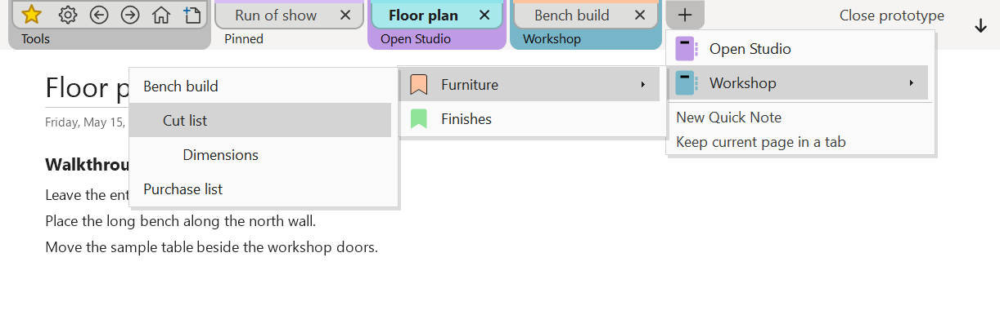
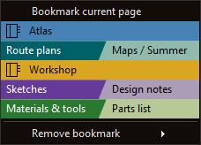

# MoreTabs


MoreTabs adds persistent page tabs, pins, and bookmarks to OneNote on Windows desktop. Pages from different notebooks open in the same editor. The prototype is part of [MoreNotes](../../README.md) and uses the release identifier `page-tabs`.



[Watch MoreTabs in action](../../README.md#switch-notebooks-with-a-click)

## Run the prototype

With OneNote desktop open in normal editing view, run these commands from the repository root in Windows PowerShell. The first builds the prototype and the second starts it.

```powershell
& .\addins\page-tabs\tools\Start-MoreTabsPrototype.ps1 -Mode Build
& .\addins\page-tabs\artifacts\prototype\Run-MoreTabs.cmd
```

The launcher uses the .NET Framework x64 compiler and the installed OneNote 15 interop assembly. It builds a local executable under `artifacts/`. Open OneNote in normal editing view with the Quick Access Toolbar below the ribbon. MoreTabs detects both **Horizontal Tabs** and **Vertical Tabs**.

| Mode | What it tests |
| --- | --- |
| `Build` | Retains a standalone x64 executable and a double-click launcher, `artifacts/prototype/Run-MoreTabs.cmd`. |
| `Measure` | Reports window handles, DPI, control bounds and native hit-test results for each measured window. Samples the left, center and right of the ribbon dock and section row without sending clicks or reading page content. |
| `Placement` | Exercises the down and up arrows in the selected OneNote frame. Checks that the reserved row survives 1.2 seconds in each position, checks hit targets and restores the original document bounds. Supply `-WindowHandle <number>` from Measure to select among several windows. |
| `Com` | Opens the desktop COM interface and checks if the current window has a readable page ID. |
| `Bind` | Matches the measured native editor to a OneNote COM window. Prints handles and bounds without moving controls or navigating. |
| `Verify` | Creates two disposable notebooks, keeps three pages, and picks a page from the second notebook through **+**. Checks that it opens in a new focused tab and the original tab returns to its page. Also checks two **New Quick Note** selections with the destination set to a test section. Attempts to restore the original page and close the test notebooks. The disposable notebook files stay in the temporary directory. |
| `HandsOn` | Sets up the same three disposable tabs and keeps the strip open for mouse and keyboard input. On **Close prototype**, checks for a typing marker in the disposable B page, restores the original page and closes the test notebooks. |
| `Run` | Restores the saved tabs in the matched editor and follows its current page. When that editor closes, the running prototype waits for another compatible OneNote editor. **Close prototype** exits the program. |
| `SelfTest` | Exercises a controlled window and starts fresh prototype processes to verify disk persistence, bookmark reopening, and an intentionally empty session. Uses isolated temporary data. |

`Bind`, `Verify`, `HandsOn` and `Run` enumerate the visible layouts, then compare each COM window's top-level ancestor to the measured frames. They prefer the current COM window when it matches. If it cannot identify an editor, a single matching COM window is sufficient. With several candidates, supply `-WindowHandle` with the decimal frame number from the current measurement. The handle selects the initial attachment. A restarted editor receives a new handle.

### Saved tabs and bookmarks

MoreTabs starts below the Quick Access Toolbar. Click the down arrow at the far right to move the whole strip to the bottom edge of the OneNote window. Click the up arrow to put it back. Both positions use the same tabs, active page and bookmarks. At the bottom, the tabs have rounded upper corners and a section-color stripe along the lower edge. The bookmarks menu opens upward. The move arrow stays visible when tabs overflow.

MoreTabs uses OneNote's notebook navigation background in both tab views. In horizontal view it also aligns the star with the native notebook icon. In vertical view it samples the upper-left notebook navigation header and uses a DPI-scaled inset. The strip refreshes as the theme changes. While the header is hidden or covered, it keeps the last measured color. Until the first measurement it uses the Office or Windows theme setting. Windows high-contrast colors take precedence.




The first rounded tab is labeled **Tools**. From left to right it holds Bookmarks, Settings, Back, Forward, Home, and New note. Back and Forward use OneNote's own page history in the associated window. With colored notebook labels on, a small gap separates Tools, Pinned, each notebook group, and the **+** page picker. Vertical dividers return when you turn off notebook colors, labels, or grouping, or when Windows uses high contrast. With notebook grouping off, unpinned tabs share one group.

Open **Settings → Visible tool buttons** to show or hide Bookmarks, Back, Forward, Home, and New note individually. All five start enabled. Changes take effect immediately and carry over to the next session. The Settings gear always stays on the strip.

Choose **Settings → Home page** to pick a page from any open notebook. Clicking Home before setup opens that picker and takes you to the page you select. Changing Home through Settings saves the destination for your next visit.





**New note** creates a page and opens it in a new focused tab. It uses the user's OneNote Quick Notes section by default. Choose **Settings → New note location** and select a section to change it, or **Use default Quick Notes** to reset it. The **+ → New Quick Note** command always uses Quick Notes.

All three grouping and label options start enabled. Changes apply immediately. MoreTabs remembers your label and color choices when you turn grouping off and when you restart.

| Option | When turned off |
| --- | --- |
| **Group tabs by notebook** | Unpinned tabs return to saved tab order. Both label options are grayed out and OneNote gets the whole caption row back. |
| **Show notebook labels** | Tabs stay grouped. All captions, including **Pinned**, disappear and OneNote gets the whole row back. The label color option is grayed out. |
| **Use notebook colors for labels** | The notebook bands disappear and the labels use the theme's regular text color. Windows high contrast uses the system background and text colors. |

With grouping on, the notebook color spans the caption and the space behind its visible tabs. Each end of the colored band has the same padding as the gap between two tabs. A thin, darker outline separates each page tab from the band. The notebook name is vertically centered in the caption, with black or white text chosen for contrast. The band is rounded along the edge facing the page, below the tabs when docked at the top and above them when docked at the bottom. The name starts one corner radius in from the first visible tab. Hover over a clipped caption to read its full name.

The Tools buttons share the outline of an inactive page tab. A neutral gray band wraps the buttons and their label, follows the OneNote theme, and resizes to fit the visible tools. Windows high contrast uses the system control and text colors. Pinned uses the strip background.

Groups appear in order of their first open tab. Tabs within a group keep their saved order. Notebook IDs distinguish notebooks with the same name.

The bookmarks menu lists notebooks alphabetically, with each notebook's icon and name on a band in its color. Within each notebook, pages appear in the order they were bookmarked. Each section label uses the native section tab color and ends in a forward-slanted edge. The page title sits on the muted section color. One shared column aligns titles across all notebook groups, including in the removal menu. Long section names are ellipsized once the column reaches half the screen's working width.

MoreTabs refreshes notebook and section names and colors when the menu opens and remembers them for offline use. Existing bookmarks gain their section labels automatically when OneNote can locate them. A bookmark whose section has never been resolved shows “Unknown section” in a theme color.



Every open page tab has a full-width stripe matching its native section tab. The stripe is three pixels high at 100% scaling and keeps the same thickness when selected. The selected tab has a muted section-color fill and a contrasting title. Pinned and regular tabs both follow this rule. MoreTabs reads section colors for restored tabs without opening their pages and refreshes them when sections are recolored. Automatic or unavailable colors use a theme accent. Windows high contrast uses the system palette. Naming or renaming the displayed page updates its tab title.

The stored section RGB and the painted section tab can differ. MoreTabs maps the 16 standard section colors to the Fluent light and dark palettes from desktop OneNote build `16.0.20715.20004`. It checks the selected section's band along the bottom of native navigation to identify the palette when visible. On that build at 96 DPI, a section stored as `#91BAAE` painted a `#006168` band in dark mode.

MoreTabs pauses while File or Options hides the editor row or opens a modal dialog. When you return to the editor, it measures the theme again and resumes automatically. The November 24 desktop test confirmed that the strip reappeared after changing the Office theme and leaving Options, without relaunching MoreTabs.

Following OneNote's page list, a link, or Back updates the page in the active tab. With grouping enabled, an unpinned tab moves to the destination notebook's group. A pinned tab stays under **Pinned**. Two tabs can display the same page. Clicking either tab selects that specific tab for subsequent navigation. Bookmarks keep pointing to the page you bookmarked.

Start `Run-MoreTabs.cmd` from the build output or use `-Mode Run` from desktop PowerShell. On first use, the strip starts with the displayed page. Subsequent runs restore the saved tab order, including an intentionally empty row. OneNote chooses its opening page. A matching tab highlights automatically.

- Click **+** to see open notebooks in OneNote order, each with a colored notebook icon and its display name. Hover over a shortened name to read it in full. Choose a notebook, browse its section groups and sections, then select a page to open it in a new, focused tab. Press **Esc** to back out. The Home page and New note location pickers use the same notebook list.
- Section groups have a folder icon. Each section has a notched marker in the same section color used on its MoreTabs tab. Windows high contrast uses system colors. **New note location** ends at the section you select.
- In **+** and **Home page**, subpages stay directly below their parent in OneNote order, with one indent per level. Click any page, including a parent, or highlight it and press **Enter**. Hover over a subpage to see its parent path when two pages have the same title.
- The **+** menu also offers **New Quick Note** to create a page in your configured Quick Notes section and **Keep current page in a tab** to keep the page on screen.
- Click **×** at the right edge of any page tab to close it, including pinned tabs and tabs in the overflow menu. You can also middle-click a tab, choose **Close tab** from its right-click menu, or press **Delete** while a page tab has keyboard focus. Closing a tab leaves the page in OneNote and preserves its bookmarks.
- Right-click a MoreTabs tab and choose **Open in new tab** for a separate, focused, unpinned copy in the same window. In OneNote's own page list, right-click a single page title and look just above **Rename** for the same command. The native text menu also offers it. Right-clicking the page-list background offers **Open current page in new tab**.
- To test the native page command, start on page A and right-click page B in the same window. Leave the menu open briefly, then choose **Open in new tab**. The tab count should increase by one with B selected. Click the original tab to return to A. The launcher reports the new tab count when the strip saves it.
- Right-click a tab and choose **Pin tab** to move it into the pinned group. Its pin follows the tab as you navigate and survives a restart. Choose **Unpin tab** to return it to its original order among the regular tabs.
- Click the star and choose **Bookmark current page**, or right-click a tab and choose **Bookmark this tab**. Choose a saved page from the star menu to reopen it in the same editor. **Remove bookmark** removes only the bookmark.
- Leave the prototype running when closing OneNote to let it attach when OneNote reopens. After exiting the prototype or restarting Windows, launch it again. The prototype has no installer or sign-in startup entry.

Tabs and bookmarks share one user-local file at `%LOCALAPPDATA%\MoreNotes\MoreTabs\working-set.xml`. Each edit saves the page ID, caption and OneNote desktop hyperlink when available. File updates merge under a short write lock and replace the prior version atomically. Separate attached windows use the same saved working set. The saved file contains notebook metadata and belongs outside public diagnostics.

The launcher registers a per-user COM DLL for OneNote's native menus. On attachment MoreTabs asks OneNote to refresh its registered add-ins and connect the helper when enabled. If a native command is missing, use the MoreTabs **gear → Connect OneNote page menu**. This reconnects the helper and displays OneNote's response. If OneNote has disabled it, see **File → Options → Add-ins**. After upgrading a connected helper, a full OneNote restart may be necessary to load the new DLL. From the checkout, run `& .\addins\page-tabs\tools\Set-MoreTabsPageMenu.ps1 -Mode Status` to check registration and whether OneNote initialized this build's ribbon. Use `-Mode Remove` to unregister the helper and restart OneNote. The strip's own tab menu works independently of the helper.

MoreTabs first navigates using the saved page ID. If OneNote rejects it, MoreTabs tries the saved OneNote link in the same window. An unavailable page stays in the list for retry or removal. Restoring caret position, selection and scroll offset remains unverified.

### Hands-on test

Run the launcher with `-Mode HandsOn` in a desktop PowerShell window. Wait for the three tabs and the console's READY message.

1. From Dashboard in MoreTabs A, click **Schedule** in OneNote's own page list. The same tab should keep its colored bar and become Schedule, alongside the original Schedule tab. Use **Back** and watch the first tab return to Dashboard. Choose **+ → New Quick Note**, name it in its title field, and check that its active tab adopts the title.
2. From **Dashboard / MoreTabs A**, put the caret in the page body and press **Ctrl+Alt+F6** to focus the active page tab. Press **Right** twice and **Enter** to open Dashboard in MoreTabs B. Without clicking, type `MoreTabs focus OK`. Try **Ctrl+Alt+F6** followed by **Escape** to return without navigating. The interactive prototype requests the shortcut while its editor is in the foreground and reports any registration conflict. Left and Right select a strip item, Enter activates it, and Escape exits the strip.
3. Resize the window, maximize and restore it, then collapse and expand the ribbon. Pause briefly after each change and check the strip and both adjacent rows. If available, move the window to a display with a different scale setting.
4. Choose **Close prototype**. The output reports displayed test pages, highlighting, sampled layout changes, DPI and whether the B page body contains the marker. The operator supplies the observations about input method and focus. A normal exit alone does not establish that each step was exercised.

### Live desktop verification

On November 24, 2026, the live verifier passed in OneNote `16.0.20715.20004` (x64) at 96 DPI. The verifier renamed a Quick Note, navigated its tab to the Dashboard page already open in a different tab, and returned to the renamed note. A subsequent live run also pinned and unpinned a tab while preserving the selection. The notebook icon started 25 pixels into the navigation row on a `#110C08` background. Controlled tests checked that the star's visible edge matches the notebook icon in dark, light and high-contrast palettes at 96, 120, 144 and 192 DPI.

On November 24, 2026, prototype `bb88678` passed `Verify` in Windows desktop OneNote `16.0.20715.20004` (x64) at 96 DPI. The COM window handle belonged to a child of the measured editor frame. Matching its top-level ancestor selected the correct editor.

| Check | Observed result |
| --- | --- |
| Reserved row | The 1,345-pixel-wide strip occupied Y=216–247 below the ribbon and Quick Access Toolbar. The native section row moved from Y=216 to Y=248. The strip held its space during the 1.2-second idle test and through page switches. Win32 hit tests reached each row at left, center and right. |
| Page switching | The verifier exercised the add and tab click handlers on three disposable pages from two notebooks, including two pages titled Dashboard. All five tab selections reached the expected page ID in the same window. |
| Return and close | Returning to the original untracked page through COM cleared the active tab highlight. The verifier closed the test notebooks, released the row and exited with code 0. A separate measurement confirmed the original document bounds and section row at Y=216. |

The saved-session verification also passed in the live editor on the same x64 build at 96 DPI. With the ribbon dock ending at Y=78, the strip moved the navigation row to Y=110. The verifier saved three disposable tabs across two notebooks, bookmarked one and closed its tab. A fresh strip read the file, restored the two remaining tabs, and reopened the bookmarked page in the other notebook in the same editor. The verifier restored the preceding page, released the row and exited with code 0.

The controlled suite separately verified restoration across fresh processes, an empty saved session, bookmark removal, fallback from an obsolete page ID, and concurrent writes from independent stores. It also closed a controlled editor while the interactive loop was running and restored the saved row in a second editor.

On November 24, 2026, prototype `b7c1fd7` passed the Quick Notes test in Windows desktop OneNote `16.0.20715.20004` (x64) at 96 DPI. Two **+** clicks created two distinct pages in the second test notebook’s Quick Notes destination. Each page opened in its own tab in the original editor, and each new tab received keyboard focus. The verifier also resolved the user's configured Quick Notes section. It wrote the test pages only in the disposable notebook and exited with code 0.

The Windows control test also exercised delayed navigation, an unavailable destination, and retrying a created tab after navigation failed.

The next live checks cover physical mouse and keyboard input, native page-list and Back navigation, resizing, ribbon collapse, and movement between displays with different scale settings. Before-and-after screenshots of test content are still pending.

In the first hands-on run, the native page-list and Back sequence displayed Schedule A and Dashboard A with their matching tabs highlighted. Dashboard B also highlighted. During ribbon changes the strip moved from Y=216 through Y=162 and Y=113 to Y=78. Each sample retained a 32-pixel row and passed all three hit tests at 96 DPI. The operator reported typing and mouse interaction worked and identified one failure: neither F6 nor Tab reached the strip from the page. The log ended at Ctrl+C before the marker and cleanup checks. Window-width and mixed-DPI changes were not recorded. A subsequent measurement still found a 32-pixel gap. Resize the host to let OneNote lay it out again after an interrupted run.

The revised prototype provides Ctrl+Alt+F6 as a direct keyboard entry point. A controlled window test starts in an editor field, focuses the strip, selects an adjacent tab with Right and Enter, then verifies Escape returns without navigating. Live keyboard results require the desktop retest.

### Earlier measurements and controlled tests

The probe initially measured three OneNote frames on the same Office build at 96 DPI. In each, the top ribbon dock ended at client Y=216 and a 48-pixel native navigation window began there. In one frame an open side pane left 985 pixels for the document in a 1,410-pixel client width. The strip therefore follows the document width.

The Work shell could measure the editor. Moving its document returned Win32 error 5, and COM activation returned `0x80070005`. The successful verification above ran under the signed-in Windows desktop account.

The desktop accessibility tree exposed the expanded ribbon, Quick Access Toolbar and Sections tab control. The original verifier required an exact match between the COM handle and the editor frame and could report a missing layout even when these controls were visible.

The controlled-window test passed child attachment, three ribbon/size configurations, preservation of the document's bottom edge, repeated layout passes without cumulative resizing, and restoration on close. Page tests passed with separate IDs for two pages titled Dashboard, repeated add, switching tabs, and navigating to an untracked page. Use `Run` for the remaining manual acceptance checks, including clicks on native controls, Back, keyboard focus, and a move between displays at different scale settings. Capture test content only.

On the 1,345-pixel-wide editor described above, the read-only Windows hit test reached the ribbon dock at Y=215 and the native navigation child at Y=240 at all three sampled positions. A controlled test placed another control over the left third of the navigation row. The original center-only check passed incorrectly. The revised check detected the obstruction and passed once the covering control was removed. The live `Placement` command still stopped at the document move with Win32 error 5, before it could attach a strip.

## First milestone

Prove same-window navigation and the requested placement on Windows desktop. Use three disposable pages across two notebooks. Give two pages the same title to verify that selection uses the page reference. Record the Office build, architecture, display scaling and results for each test.

| Test | Acceptance criteria |
| --- | --- |
| Placement | With the Quick Access Toolbar below the ribbon and horizontal section tabs active, the new strip occupies its own row directly between the toolbar and native notebook/section row. Both native rows and the editor remain fully visible and clickable. Capture before and after views of test content. |
| New tab and navigation | Open **+** and dismiss it. The page and tab count should stay the same. Reopen it, pick a page in another notebook, and check that it opens in a separate focused tab. Return to the original tab to check its page. Choose **+ → New Quick Note** to verify the configured Quick Notes destination. |
| Native navigation | Use the page list, section navigation or Back to visit another page. The same tab stays selected, shows the new title and appears under the destination notebook. If another tab already shows that page, both remain open and exactly one is active. |
| Layout | Resize and maximize/restore the window. Collapse/expand the ribbon. Check at 100% and 150% scaling and across monitors with different scaling when available. Verify alignment, click targets, native controls and page content each time. Record unavailable configurations as untested. |
| Keyboard focus | Navigate and activate tabs with the keyboard, return focus to the page, and type into a test page. Repeat after using native navigation. No stolen keystrokes, unexpected window activation or focus trap. |

Start by identifying whether OneNote can reserve vertical space at the target location. Observe the native layout and accessibility tree while resizing or collapsing the ribbon. An element's visible rectangle identifies a measurement target only. Record how, or whether, the host participates in allocating space for the strip. If a test fails, document the method, reproducible failure and affected configuration. Present alternative layouts and their tradeoffs for a decision before adopting one.

## Technical findings

| Evidence | Implication |
| --- | --- |
| The desktop COM window interface exposes `WindowHandle`, `CurrentPageId`, `CurrentNotebookId` and `NavigateTo`. | Bind a tab collection to the intended window. Read the page ID from that window to verify a navigation. [Microsoft window interfaces](https://learn.microsoft.com/en-us/office/client-developer/onenote/window-interfaces-onenote) |
| The application interface provides hierarchy, linking and navigation methods and describes navigation events. | Evaluate native navigation events against Back and section changes. Check the window identity again when handling an event. [Microsoft application interface](https://learn.microsoft.com/en-us/office/client-developer/onenote/application-interface-onenote) |
| Microsoft's archived desktop sample demonstrates a OneNote COM add-in and setup. The Office.js OneNote overview targets the web. The VSTO application matrix lists the supported hosts. | The COM sample is a starting point. An extension point for this exact row is still unverified. Neither Office.js nor a standard VSTO custom task pane establishes that placement. [COM sample](https://github.com/OneNoteDev/VanillaAddIn) · [Office.js overview](https://learn.microsoft.com/en-us/office/dev/add-ins/onenote/onenote-add-ins-programming-overview) · [VSTO host matrix](https://learn.microsoft.com/en-us/visualstudio/vsto/features-available-by-office-application-and-project-type?view=visualstudio) |

The prototype recognizes a native ribbon dock adjacent to the document. It checks which window actually receives input across the horizontal navigation row or, in vertical view, across the page workspace. It reserves space by shortening the whole document, including its side panes, and checks the new bounds before showing the strip. The native window classes are observations from the tested build. `Measure` and `Placement` work without reading or writing notebook content.

On November 24, 2026, live measurement in Vertical Tabs on OneNote `16.0.20715.20004` (x64, 96 DPI) found a 36-pixel navigation row behind the notebook panes and page workspace. The old startup check hit the workspace at the center of that row and retried indefinitely. The updated probe found the workspace at X=432, Y=226 and passed all three hit tests. The development session received Win32 error 5 during live placement. Controlled Windows tests cover startup, both docking positions, expanded and collapsed vertical panes, switching between layouts, and restoring the original document bounds.

Bottom placement requires a document that reaches both sides and the bottom of the frame's client area. MoreTabs shortens that document from below, including its native footer. A separate frame control occupying the proposed row prevents the move. On November 24, 2026 the live 96-DPI window measured 1345 × 1170 client pixels, with the document filling the width and reaching the bottom. Live repositioning from the development session was blocked by Win32 error 5. The placement round trip, footer hit area, resize, modal resume, overflow and mirrored rendering have been checked in a controlled Windows window.

## Follow-up requirements

- Decide how users can reorder tabs within each group.
- Verify OneNote references after renaming or moving pages, closing and reopening notebooks, and deleting pages. Exercise the resident prototype across a full desktop OneNote restart.
- Test page restoration separately from caret, selected text and scroll offset. Record what OneNote restores itself and what the add-in can reliably restore.
- Evaluate whether users need separate working sets per window and folders for organizing bookmarks.
